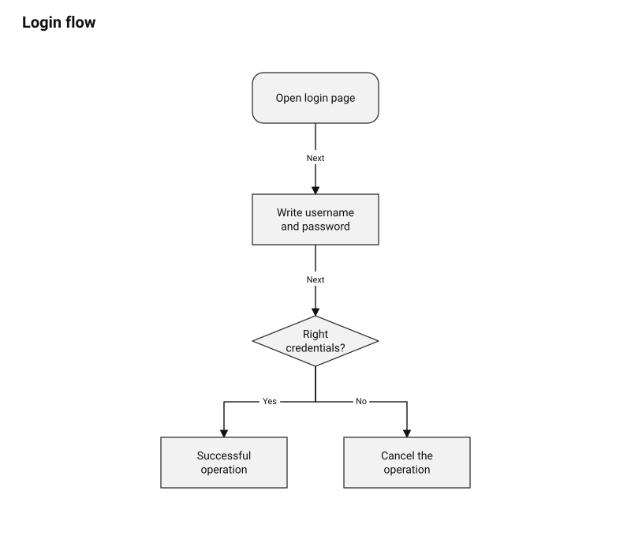
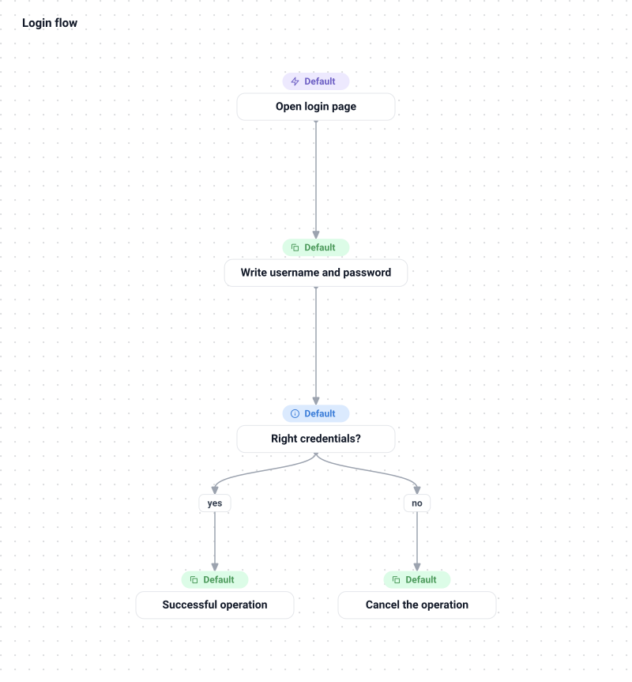

# diagram-dsl

A Java DSL for describing block diagrams (`.bck` files), with a lexer, parser, semantic
analyzer, and an SVG renderer that ships two visual themes

Requires JDK 25 or newer. The project-local `./mvnw` selects a compatible installed JDK
and uses its own Maven Central configuration.

## Quick Start

### 1. Run the analyzer (prints the parsed model)

```bash
cd diagrams
./mvnw -q package
./mvnw -q exec:java -Dexec.args="examples/example.bck"
```

### 2. Render an SVG diagram

```bash
./mvnw -q exec:java -Dexec.args="examples/example.bck --theme default"
./mvnw -q exec:java -Dexec.args="examples/example.bck --theme custom"
```

Without `--theme`/`--output`/`--selected`, the command just prints the analyzed model instead
of rendering. Full options:

```text
Usage: java moon.example.Main [input.bck] [options]
  --theme default|custom   rendering theme (default: default)
  --output, -o PATH        output SVG file (default: <input>-<theme>.svg next to the input)
  --selected NODE          render one node as selected
  --png                    also export a PNG next to the SVG
  --help, -h               show this help
```

## Themes

- **`default`** — rounded terminators, rectangular processes, diamond decisions, orthogonal black connectors

  

- **`custom`** — rounded white cards, colored category badges with Lucide icons, and curved branch forks

  

## Labels, badges, and icons

The DSL has several independent text labels:

| API | Meaning | Rendering |
| --- | --- | --- |
| `diagram.setTitle("...")` | Diagram title | Heading above the canvas |
| `diagram.setDescription("...")` | Optional diagram description | Secondary heading text |
| `node.setTitle("...")` | Main node label | Text inside the flowchart shape or workflow card |
| `node.setBadgeLabel("...")` | Custom-theme category caption | Colored pill above the workflow card |
| `relation.setLabel("...")` | Explicit edge label | Text near the line in `default`, a branch pill in `custom` |

Sugar relations use their type as the edge label when no explicit label is supplied:
`setNext` renders `Next`, `setYes` renders `Yes`, and `setNo` renders `No`.

The custom theme accepts these badge categories:

| Value | Intended use |
| --- | --- |
| `launch` | Entry points and triggers |
| `finish` | Completion, cancellation, or failure |
| `action` | Processing steps and commands |
| `condition` | Decisions and checks |

Use `node.setBadgeIcon("<name>")` to override the category icon. Supported Lucide icons:

| Name | Description |
| --- | --- |
| `zap` | Lightning bolt for triggers and start actions |
| `copy` | Overlapping squares for copy and duplicate actions |
| `info` | Information marker for conditions and explanatory steps |
| `circle_x` | Circled cross for cancellation, failure, and finish actions |
| `question_mark` | Question mark for checks, retries, and unresolved states |

```java
cancelAction.setBadgeLabel("Cancelled");
cancelAction.setBadgeCategory("finish");
cancelAction.setBadgeIcon("circle_x");
```

Unknown icon names are semantic errors. For close misspellings the analyzer reports a hint,
for example `circle_b` suggests `circle_x`.

## Writing a diagram

```java
BlockDiagram diagram = new BlockDiagram();
diagram.setTitle("Login flow");

Terminator start = new Terminator();
start.setTitle("Open login page");

Decision check = new Decision();
check.setTitle("Right credentials?");

start.setNext(check);
diagram.addBlock(start);
diagram.addBlock(check);
```

See [`examples/example.bck`](https://github.com/moonPrTea/dsl-library/tree/main/diagrams/examples) for a complete diagram with a
branch (`setYes`/`setNo`)
